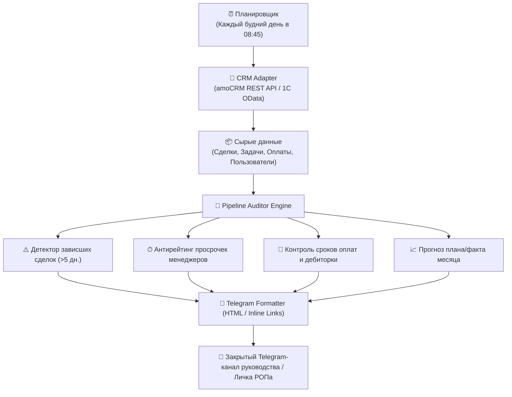

# 📊 B2B Executive Briefing & Pipeline Auditor

> **Автоматический аудит воронки продаж, выявление зависших сделок (> 5 дней без движения), контроль просроченных задач и дебиторской задолженности с утренней доставкой в Telegram РОПа в 08:45.**

[](tests/)
[](https://python.org)
[](https://www.amocrm.ru)
[](LICENSE)

**▶️ Интерактивное веб-демо:** https://kilevoy.github.io/b2b-executive-briefing/

> [!NOTE]
> **Дисклеймер:** Все числовые показатели плана/факта, суммы сделок, названия контрагентов и дебиторская задолженность в репозитории и интерактивном стенде являются смоделированными (демо-данными) для защиты коммерческой тайны и демонстрации архитектуры.

---

## 🎯 Бизнес-проблема и эффект (ROI)

* **Проблема:** В B2B-продажах с длинным циклом сделки (1–3 месяца) до 30% потенциальной выручки «умирает» в воронке молча: коммерческое предложение отправлено, звонка не было 10 дней, клиент ушёл к конкуренту. Руководитель отдела продаж (РОП) узнаёт об этом только в конце месяца при срыве плана. Утренние планёрки тратят по 40–50 минут на ручной опрос каждого менеджера («Что у тебя по сделке Х?»).
* **Решение:** Сервис ежедневно в 08:45 опрашивает CRM (amoCRM / 1С / Битрикс24), анализирует воронку по алгоритму поиска «висяков», сопоставляет выполнение плана с текущим днём месяца, выявляет просроченную дебиторку и формирует для РОПа структурированный дайджест в Telegram с готовой повесткой на 10-минутную летучку.

| Метрика | До внедрения | После внедрения дайджеста |
| :--- | :--- | :--- |
| **Время утренней планёрки РОПа** | 45–60 минут (ручной перебор сделок) | **10–15 минут (точечный разбор аномалий)** |
| **Сделки, забытые менеджерами (>5 дней)** | 15–25% активной воронки | **0% (каждая сделка подсвечивается до отвала)** |
| **Контроль дебиторки (DSO)** | Постфактум по банковской выписке | **Упреждающий контроль за 3–5 дней до просрочки** |
| **Предсказуемость прогноза выручки** | «По ощущениям менеджеров» | **Математический прогноз по фактическому темпу** |

---

## 🏗 Архитектура решения



---

## 📋 Структура утреннего отчёта в Telegram

Каждое утро в 08:45 руководитель получает лаконичное сообщение из 6 смысловых блоков:

1. **🎯 План / Факт месяца:**
   * Прогресс-бар выполнения (`[███████░░░] 67.4%`).
   * Текущий факт выручки vs целевой план месяца.
   * Математический прогноз закрытия месяца при сохранении текущего темпа.
2. **⚠️ Зависшие сделки (> 5 дней без движения):**
   * Суммарный объём зависших денег (например, *«Зависло: 16.6 млн ₽ в 4 сделках»*).
   * Топ сделок с цветовой индикацией риска:
     * 🔴 **CRITICAL (> 14 дней):** высокий риск отвала клиента.
     * 🟠 **MEDIUM (8–14 дней):** требуется вмешательство руководителя.
     * 🟡 **LOW (5–7 дней):** напоминание менеджеру.
   * Прямые кликабельные ссылки для мгновенного перехода в карточку сделки в CRM.
3. **⏱ Просроченные задачи менеджеров:**
   * Список задач с нарушенным дедлайном (кто, сколько дней просрочки, суть действия).
4. **💸 Контроль дебиторской задолженности (DSO):**
   * Счета с нарушением сроков постоплаты и критические алерты по отгрузкам.
5. **🏆 Лидерборд менеджеров:**
   * Рейтинг сотрудников по % выполнения плана и количеству активных просрочек.
6. **👉 Фокус дня для РОПа:**
   * 3 конкретных управленческих действия на утреннюю планёрку (например: *«Разобрать топ-2 зависшие сделки Карпова», «Приостановить отгрузку ООО ТехноПромСервис до погашения задолженности»*).

---

## 🚀 Быстрый старт

### 1. Клонирование и установка
```bash
git clone https://github.com/kilevoy/b2b-executive-briefing.git
cd b2b-executive-briefing
pip install -r requirements.txt
```

### 2. Запуск тестов (Pytest)
```bash
python -m pytest
```

### 3. Мгновенный предпросмотр отчёта в консоли
Запуск скрипта в автономном демонстрационном режиме (без внешних ключей):
```bash
python -m briefing.cli --preview
```

### 4. Настройка боевой отправки в Telegram
Скопируйте конфигурацию и укажите ключи:
```bash
cp .env.example .env
```
Запуск боевой отправки:
```bash
python -m briefing.cli --send
```

---

## 📁 Структура репозитория

```text
b2b-executive-briefing/
├── briefing/                  # Пакет аналитики и рассылки
│   ├── __init__.py
│   ├── models.py              # Pydantic модели (StalledDeal, OverdueTask, ManagerStats)
│   ├── crm_adapter.py         # Выгрузка из amoCRM REST API v4 (+ реалистичный Mock)
│   ├── analyzer.py            # Движок аудита воронки и выработки рекомендаций
│   ├── telegram_formatter.py  # Верстка представительского HTML-отчёта для Telegram
│   ├── scheduler.py           # Сервис запуска и отправки в Telegram
│   └── cli.py                 # Консольная утилита (CLI preview & send)
├── tests/                     # Автоматические тесты
│   └── test_briefing.py
├── web/                       # Интерактивное веб-демо (GitHub Pages)
│   └── index.html
├── .env.example               # Конфигурация
├── requirements.txt           # Зависимости
├── pytest.ini                 # Настройки тестов
└── README.md                  # Документация проекта
```

---

## 👨‍💼 Автор

**Андрей Рыкунов** — коммерческий руководитель с 26-летним опытом в B2B и автоматизации коммерческих процессов.
* Portfolio: [kilevoy.github.io](https://kilevoy.github.io)
* GitHub: [@kilevoy](https://github.com/kilevoy)
* Telegram: [@rykunov](https://t.me/rykunov)
* Email: rykunov@gmail.com

